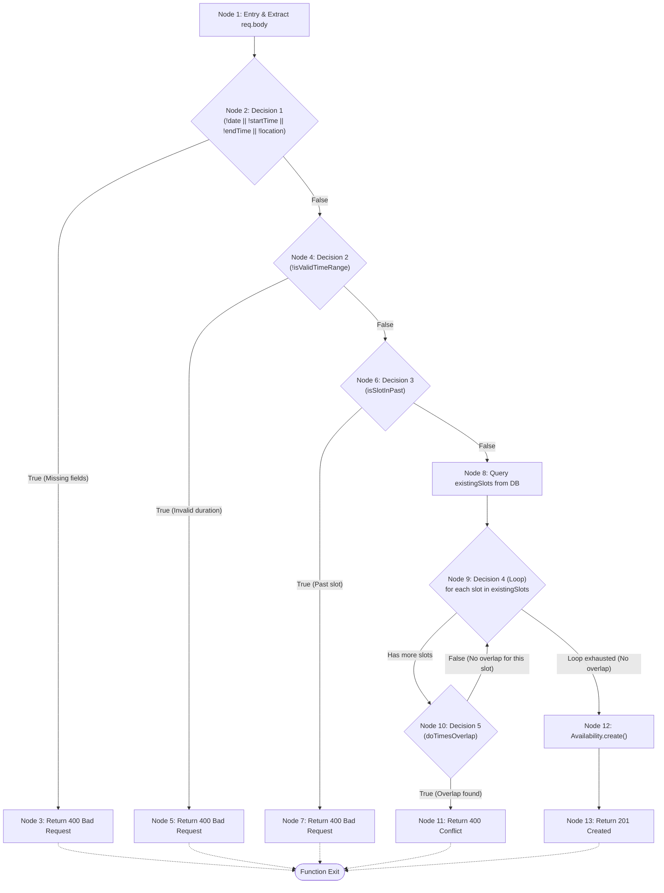

# 3.4 White-Box Testing (LO-2)

**Module:** EC4206 – Software Testing and Quality Assurance  
**System Under Test:** Smart Lecturer Appointment Management System (MERN Stack)  
**Author:** Member 2 (Black-Box & White-Box Test Design)  
**Branch:** `member2-test-design`  

---

## 1. Methodology & Theoretical Foundation
White-box (structural) testing evaluates the internal procedural logic, control flows, basic blocks, decision predicates, and execution paths of software components. Unlike black-box testing, which verifies external input-output behavior against functional requirements, white-box testing ensures that:
1. Every individual statement in the codebase is exercised at least once (**Statement Coverage**).
2. Every boolean decision outcome (True and False branches) of all control statements (`if`, `for`, `while`) is traversed (**Branch Coverage**).
3. All linearly independent execution paths through the code are tested using structured basis path analysis (**Basis Path Testing**).

In this section, we analyze the primary business controller `createAvailability` in `backend/controllers/availabilityController.js`. We also provide a supplementary structural analysis for the core temporal logic function `isValidTimeRange` in `backend/utils/dateUtils.js`.

---

## 2. Primary Analysis: `createAvailability` Controller

### 2.1 Source Code with Node Annotations

The availability creation controller (`backend/controllers/availabilityController.js`, lines 48–110) governs slot publishing by lecturers. The source code is partitioned into **Basic Blocks (Nodes)** and **Decision Points**:

```javascript
// backend/controllers/availabilityController.js
export const createAvailability = async (req, res, next) => {
  try {
    // ----------------------------------------------------
    // NODE 1: Entry basic block & request payload extraction
    // ----------------------------------------------------
    const { date, startTime, endTime, location, meetingMethod, notes } = req.body;

    // ----------------------------------------------------
    // NODE 2: Decision 1 - Mandatory fields guard
    // ----------------------------------------------------
    if (!date || !startTime || !endTime || !location) {
      // NODE 3: Error exit 1
      return res.status(400).json({
        success: false,
        message: 'Date, start time, end time, and location are required',
      });
    }

    // ----------------------------------------------------
    // NODE 4: Decision 2 - Time range & duration validity
    // ----------------------------------------------------
    if (!isValidTimeRange(startTime, endTime)) {
      // NODE 5: Error exit 2
      return res.status(400).json({
        success: false,
        message: 'End time must be after start time, and slot duration must be at least 5 minutes',
      });
    }

    // ----------------------------------------------------
    // NODE 6: Decision 3 - Temporal past-date guard
    // ----------------------------------------------------
    if (isSlotInPast(date, startTime)) {
      // NODE 7: Error exit 3
      return res.status(400).json({
        success: false,
        message: 'Cannot create availability slots for past dates or times',
      });
    }

    // ----------------------------------------------------
    // NODE 8: Database query block for existing lecturer slots
    // ----------------------------------------------------
    const existingSlots = await Availability.find({
      lecturerId: req.user._id,
      date,
      status: { $ne: 'unavailable' },
    });

    // ----------------------------------------------------
    // NODE 9: Decision 4 - Loop iteration guard
    // ----------------------------------------------------
    for (const slot of existingSlots) {
      // --------------------------------------------------
      // NODE 10: Decision 5 - Overlap check condition
      // --------------------------------------------------
      if (doTimesOverlap(startTime, endTime, slot.startTime, slot.endTime)) {
        // NODE 11: Error exit 4
        return res.status(400).json({
          success: false,
          message: `This slot overlaps with an existing slot from ${slot.startTime} to ${slot.endTime} on ${date}`,
        });
      }
      // Loop continuation edge back to Node 9
    }

    // ----------------------------------------------------
    // NODE 12: Database insertion basic block
    // ----------------------------------------------------
    const newSlot = await Availability.create({
      lecturerId: req.user._id,
      date,
      startTime,
      endTime,
      location,
      meetingMethod: meetingMethod || 'in-person',
      notes: notes || '',
      status: 'available',
    });

    // ----------------------------------------------------
    // NODE 13: Normal exit block (HTTP 201)
    // ----------------------------------------------------
    res.status(201).json({
      success: true,
      message: 'Availability slot created successfully',
      slot: newSlot,
    });
  } catch (error) {
    // ----------------------------------------------------
    // NODE 14: Exception handling catch block
    // ----------------------------------------------------
    next(error);
  }
};
```

---

### 2.2 Control Flow Graph (CFG) Description & Diagram

#### Graph Description
- **Nodes ($N = 14$):** 13 basic blocks (Nodes 1 through 13) plus 1 terminal `Exit` node representing program completion.
- **Edges ($E = 18$):** 18 directed control transfers (13 internal transitions between basic blocks + 5 exit connections to the terminal `Exit` node).
- **Decision Nodes (Predicates):** Nodes 2, 4, 6, 9, 10.
- **Exit Nodes:** Nodes 3, 5, 7, 11 (error returns) and Node 13 (successful return), all joining at common program termination (`Exit`).



---

### 2.3 Cyclomatic Complexity Calculation

Cyclomatic Complexity $V(G)$, originated by Thomas J. McCabe (1976), measures the structural complexity of a program and provides an upper bound on the number of linearly independent execution paths required for full basis path coverage.

We compute and verify $V(G)$ for `createAvailability` using **three independent mathematical methods**:

#### Method 1: Edge and Node Formula
$$V(G) = E - N + 2P$$
Where:
- $E$ is the total number of directed edges in the connected CFG: **$18$**
  - Directed edges (18 total):
    - 13 internal transitions: $(1 \to 2)$, $(2 \to 3)$, $(2 \to 4)$, $(4 \to 5)$, $(4 \to 6)$, $(6 \to 7)$, $(6 \to 8)$, $(8 \to 9)$, $(9 \to 10)$, $(9 \to 12)$, $(10 \to 11)$, $(10 \to 9)$, $(12 \to 13)$
    - 5 exit connections to the terminal exit node: $(3 \to \text{Exit})$, $(5 \to \text{Exit})$, $(7 \to \text{Exit})$, $(11 \to \text{Exit})$, and $(13 \to \text{Exit})$.
- $N$ is the total number of nodes in the graph: **$14$** (Basic block Nodes 1 through 13 plus the terminal `Exit` node).
- $P$ is the number of connected components: **$1$**.

$$V(G) = 18 - 14 + 2(1) = 4 + 2 = \mathbf{6}$$

---

#### Method 2: Predicate (Decision Points) Formula
$$V(G) = P_{\text{decision}} + 1$$
Where $P_{\text{decision}}$ is the count of two-way decision nodes (predicates) containing conditional branches:
1. **Predicate 1 (Node 2):** Mandatory fields check (`!date || !startTime || !endTime || !location`)
2. **Predicate 2 (Node 4):** Duration/time-ordering validation (`!isValidTimeRange(...)`)
3. **Predicate 3 (Node 6):** Temporal validity check (`isSlotInPast(...)`)
4. **Predicate 4 (Node 9):** Loop iteration decision (`hasMoreElements(existingSlots)`)
5. **Predicate 5 (Node 10):** Overlap condition (`doTimesOverlap(...)`)

$$P_{\text{decision}} = 5$$
$$V(G) = 5 + 1 = \mathbf{6}$$

---

#### Method 3: Number of Bounded Regions in Planar Graph
$$V(G) = R$$
Where $R$ is the total count of planar enclosed regions plus 1 unbounded outer region:
- **Region 1 ($R_1$):** Enclosed loop formed by Node 9 and Node 10: $(9 \to 10 \to 9)$.
- **Region 2 ($R_2$):** Branch region between Decision Node 2 and Decision Node 4.
- **Region 3 ($R_3$):** Branch region between Decision Node 4 and Decision Node 6.
- **Region 4 ($R_4$):** Branch region between Decision Node 6 and Database Query Node 8.
- **Region 5 ($R_5$):** Branch region between Decision Node 10, Overlap Exit Node 11, and terminal exit.
- **Region 6 ($R_6$):** The infinite exterior region encompassing the entire graph.

$$R = 5 \text{ enclosed regions} + 1 \text{ exterior region} = \mathbf{6}$$

---

#### Advanced Engineering Note: Compound Condition Expansion
In standard procedural testing, a compound guard statement such as Node 2:
```javascript
if (!date || !startTime || !endTime || !location)
```
is treated as a single predicate node if evaluated as a single high-level basic block. However, if decomposed at the JavaScript interpreter level into atomic binary conditions with short-circuit evaluation:
- $C_{2a}: \text{!date}$ (1 decision)
- $C_{2b}: \text{!startTime}$ (1 decision)
- $C_{2c}: \text{!endTime}$ (1 decision)
- $C_{2d}: \text{!location}$ (1 decision)

The 3 additional boolean `||` operators add 3 decision points:
$$V(G)_{\text{decomposed}} = 6 + 3 = \mathbf{9}$$
For standard academic and structural CFG reporting, high-level condition abstraction is adopted, yielding the foundational value **$V(G) = 6$**.

---

### 2.4 Independent Basis Paths & Test Case Design

A basis path set is a maximal set of linearly independent execution paths through the CFG such that any arbitrary path through the function can be expressed as a linear combination of paths from this set. 

Because $V(G) = 6$, there are **exactly 6 linearly independent basis paths**:

#### Table 3.4.1: Basis Paths and Test Design for `createAvailability`

| Path ID | Node Sequence | Traversal Description | Concrete Test Input | Expected Result / Status |
|:---:|---|---|---|:---:|
| **Path 1** | $1 \to 2 \to 3$ | Fails required fields validation (Decision 1 = True); returns immediately | `{ date: "2026-12-15", startTime: "10:00", endTime: "11:00", location: "" }` (missing location) | `HTTP 400 Bad Request`; *"Date, start time, end time, and location are required"* |
| **Path 2** | $1 \to 2 \to 4 \to 5$ | Passes fields; fails duration validation (Decision 1 = False, Decision 2 = True) | `{ date: "2026-12-15", startTime: "10:00", endTime: "10:04", location: "Room 101" }` (4 min duration) | `HTTP 400 Bad Request`; *"End time must be after start time, and slot duration must be at least 5 minutes"* |
| **Path 3** | $1 \to 2 \to 4 \to 6 \to 7$ | Passes duration; fails past-date check (Decision 1 = False, 2 = False, 3 = True) | `{ date: "2020-01-01", startTime: "10:00", endTime: "11:00", location: "Room 101" }` (past date) | `HTTP 400 Bad Request`; *"Cannot create availability slots for past dates or times"* |
| **Path 4** | $1 \to 2 \to 4 \to 6 \to 8 \to 9 \to 10 \to 11$ | Passes past check; loop entered; slot overlap detected (Decision 4 = True, 5 = True) | Existing slot: `10:00–11:00`. New slot: `{ date: "2026-12-15", startTime: "10:30", endTime: "11:30", location: "Room 101" }` | `HTTP 400 Bad Request`; *"This slot overlaps with an existing slot..."* |
| **Path 5** | $1 \to 2 \to 4 \to 6 \to 8 \to 9 \to 10 \to 9 \to 12 \to 13$ | Existing slots exist on day; loop checks all slots with no overlap; slot created | Existing slot: `08:00–09:00`. New slot: `{ date: "2026-12-15", startTime: "10:00", endTime: "11:00", location: "Room 101" }` | `HTTP 201 Created`; *"Availability slot created successfully"* |
| **Path 6** | $1 \to 2 \to 4 \to 6 \to 8 \to 9 (\text{empty}) \to 12 \to 13$ | Zero existing slots in DB for this date; loop body bypassed entirely; slot created | Lecturer has 0 existing slots on `2026-12-25`. New slot: `{ date: "2026-12-25", startTime: "10:00", endTime: "11:00", location: "Room 101" }` | `HTTP 201 Created`; *"Availability slot created successfully"* |

---

### 2.5 Statement Coverage vs. Branch Coverage

#### Theoretical Distinction
- **Statement Coverage:** Quantifies the proportion of executable statements in the source code executed by the test suite:
  $$\text{Statement Coverage} = \frac{\text{Executed Statements}}{\text{Total Statements}} \times 100\%$$
- **Branch (Decision) Coverage:** Quantifies the proportion of decision branch outcomes (both True and False edges) traversed by the test suite:
  $$\text{Branch Coverage} = \frac{\text{Traversed Branch Outcomes}}{\text{Total Decision Outcomes}} \times 100\%$$
- **Crucial Theoretical Difference:** Statement coverage is strictly weaker than branch coverage. A test suite can achieve 100% statement coverage while completely missing empty `else` branches or unentered loop bypass edges. Achieving 100% branch coverage mathematically subsumes 100% statement coverage, but the reverse is not true.

#### Minimum Test Suite Comparison for `createAvailability`
1. **Minimum Tests for 100% Statement Coverage:** **5 Test Cases**
   - Executing Paths 1, 2, 3, 4, and 5 is sufficient to touch every line of code (Nodes 1 through 13).
   - *Note:* Path 6 is redundant for statement coverage because Nodes 12 and 13 are already traversed by Path 5.
2. **Minimum Tests for 100% Branch Coverage:** **6 Test Cases (All 6 Basis Paths)**
   - Branch coverage strictly demands that Decision Node 9 (`for (const slot of existingSlots)`) is exercised for both:
     - **True branch** (loop executes $\ge 1$ times): Exercised by Paths 4 and 5.
     - **False branch** (loop condition evaluates to False on initial check, $0$ iterations): Exercised exclusively by **Path 6**.

---

## 3. Supplementary White-Box Analysis: `isValidTimeRange`

To demonstrate structural test design on algorithmic utility logic, we analyze `isValidTimeRange` (`backend/utils/dateUtils.js`, lines 49–53):

```javascript
// backend/utils/dateUtils.js
export const isValidTimeRange = (startTime, endTime) => {
  const startMin = timeToMinutes(startTime);                                       // Statement 1
  const endMin = timeToMinutes(endTime);                                           // Statement 2
  return endMin > startMin && endMin - startMin >= 5 && endMin - startMin <= 480;  // Predicate Statement
};
```

### 3.1 Predicate Decomposition & Complexity
The return statement contains a compound boolean expression composed of 3 atomic relational conditions:
- Condition $c_1$: `endMin > startMin` (End time strictly greater than start time)
- Condition $c_2$: `endMin - startMin >= 5` (Slot duration at least 5 minutes)
- Condition $c_3$: `endMin - startMin <= 480` (Slot duration at most 480 minutes / 8 hours)

Because JavaScript utilizes short-circuit `&&` evaluation:
- If $c_1$ is False, evaluation terminates (`false`).
- If $c_1$ is True and $c_2$ is False, evaluation terminates (`false`).
- If $c_1$ and $c_2$ are True and $c_3$ is False, evaluation terminates (`false`).
- If $c_1, c_2, c_3$ are all True, returns `true`.

Cyclomatic Complexity for the compound predicate:
$$V(G) = P_{\text{atomic}} + 1 = 3 + 1 = \mathbf{4}$$

### 3.2 Branch Coverage Test Matrix for `isValidTimeRange`

| Test Case | Inputs (`startTime`, `endTime`) | $c_1: >$ | $c_2: \ge 5$ | $c_3: \le 480$ | Evaluated Result | Automated Test Reference |
|:---:|---|:---:|:---:|:---:|:---:|---|
| **TC-TR-1** | `'10:00', '09:00'` | **False** | — | — | `false` | `backend/tests/dateUtils.test.js` |
| **TC-TR-2** | `'10:00', '10:00'` | **False** | — | — | `false` | `backend/tests/dateUtils.test.js` |
| **TC-TR-3** | `'09:00', '09:04'` | **True** | **False** | — | `false` | `backend/tests/dateUtils.test.js` |
| **TC-TR-4** | `'09:00', '09:05'` | **True** | **True** | **True** | `true` | `backend/tests/dateUtils.test.js` |
| **TC-TR-5** | `'09:00', '17:00'` | **True** | **True** | **True** | `true` | `backend/tests/dateUtils.test.js` |
| **TC-TR-6** | `'09:00', '17:01'` | **True** | **True** | **False** | `false` | `backend/tests/dateUtils.test.js` |

*Result:* This 6-test suite achieves **100% statement coverage, 100% branch coverage, and 100% condition/decision coverage (MC/DC)** on `isValidTimeRange`.
